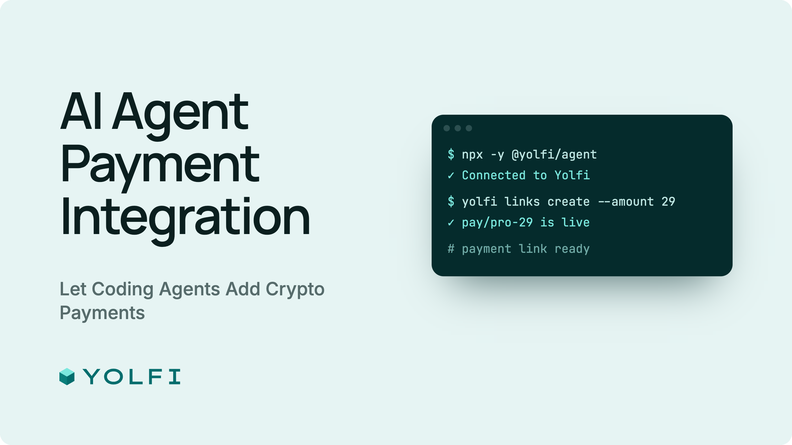

# Yolfi Agent Kit: AI エージェントによる暗号資産決済

AI エージェントで暗号資産の決済リンク、ホスト型チェックアウト、webhook 署名検証を組み込みます。ローカル MCP サーバー、JSON CLI、JavaScript SDK、Yolfi Payments Agent Skill を提供します。

```text
このプロジェクトに Yolfi 決済を追加してください。https://docs.yolfi.com/ai に従ってください。
```

対象プロジェクトのエージェントにこのメッセージを送信します。エージェントはコードを確認し、利用可能な接続方法を選び、認証後も実装を続けます。所有者が提供するのは、受取ウォレットや価格など未確定の事項だけです。

## 言語

[English](../../README.md), [Español](README.es.md), [Deutsch](README.de.md), [Français](README.fr.md), [简体中文](README.zh-CN.md), [Русский](README.ru.md), [हिन्दी](README.hi.md), [Türkçe](README.tr.md), [한국어](README.ko.md), [日本語](README.ja.md).

## ドキュメント

- [AI 統合ガイド](https://docs.yolfi.com/en/agent-kit)
- [エージェント接続](https://docs.yolfi.com/en/agent-kit/connections)
- [HTTP API](https://docs.yolfi.com/en/api)
- [CLI](https://docs.yolfi.com/en/cli)
- [英語の完全なパッケージガイド](../../README.md)

## ローカル CLI

Node.js 18 以降が必要です。npx を使えばグローバルインストールは不要です。認証がない場合、エージェントが setup を実行して所有者向けに loginUrl を開き、その後 checkin と auth:status を実行します。仮の YOLFI_API_KEY は保存済み認証情報より優先されるため設定しないでください。

```bash
npx -y @yolfi/agent help
npx -y @yolfi/agent auth:status
npx -y @yolfi/agent setup --agent local-agent
npx -y @yolfi/agent checkin --agent local-agent
npx -y @yolfi/agent auth:status
```

## MCP 接続

単一のローカルサーバーがツール、リソース、プロンプトを提供します。https://app.yolfi.com/mcp の OAuth はホストが管理します。同じホストで yolfi_auth_status を呼び出してください。別の CLI はその OAuth を読みません。接続方式はエージェント名だけでなく環境の機能で選びます。

```json
{
  "mcpServers": {
    "yolfi": {
      "command": "npx",
      "args": ["-y", "@yolfi/agent", "mcp"]
    }
  }
}
```

## 再利用とシークレット

まず組織、ウォレット、関連する決済リンク、webhook エンドポイント、プロジェクト設定を読みます。承認済みの値を再利用し、不足事項だけ質問します。settlement:configure は PATCH で指定ネットワークを更新し、他は保持します。webhooks:add は独立したエンドポイントを作るため、先に既存のものを探してください。

```bash
npx -y @yolfi/agent organization:get
npx -y @yolfi/agent paylinks:list
npx -y @yolfi/agent webhooks:list
```

--json を使う前に対象プロジェクト内に JSON ファイルを作成します。npx はパッケージの examples を作業ディレクトリにコピーしません。

ローカル CLI/MCP は webhook の作成・ローテーション時に署名シークレットを保護された設定に保存し、出力から除去します。エンドポイント ID または YOLFI_WEBHOOK_SECRET で検証してください。SDK の readWebhookSigningSecret(endpointId) で値を表示せずアプリのシークレット管理に渡せます。コマンドやツールの引数にシークレットを含めないでください。

```bash
npx -y @yolfi/agent webhooks:verify --endpoint-id <endpointId> --payload ./raw-webhook.json --signature <signature>
```

ホスト型決済リンクと公開決済照会にはアプリの API キーは不要です。非公開 Checkout Session 作成には別のサーバー認証情報と、同じ注文の再試行で使う固定の冪等性キーが必要です。エージェントの OAuth はアプリの認証情報ではありません。

## 検証

認証、コードテスト、実行環境へのシークレット設定、実際の決済と webhook 配信の検証を区別して報告します。接続成功やブラウザーのリダイレクトだけでは全体の動作を証明できません。
